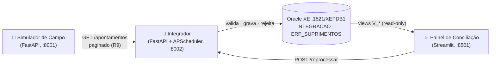
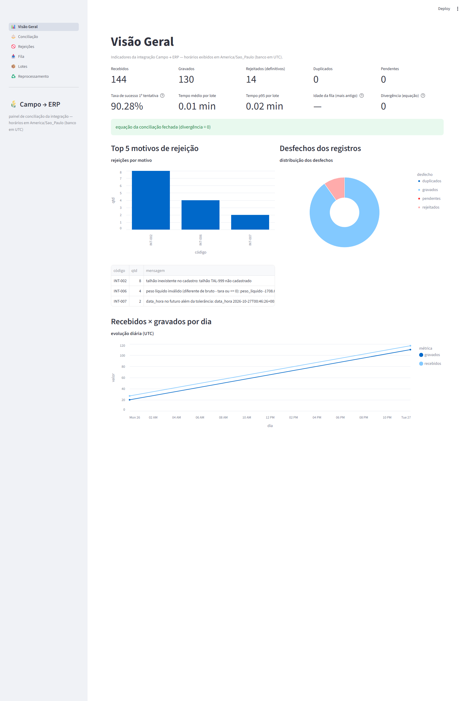
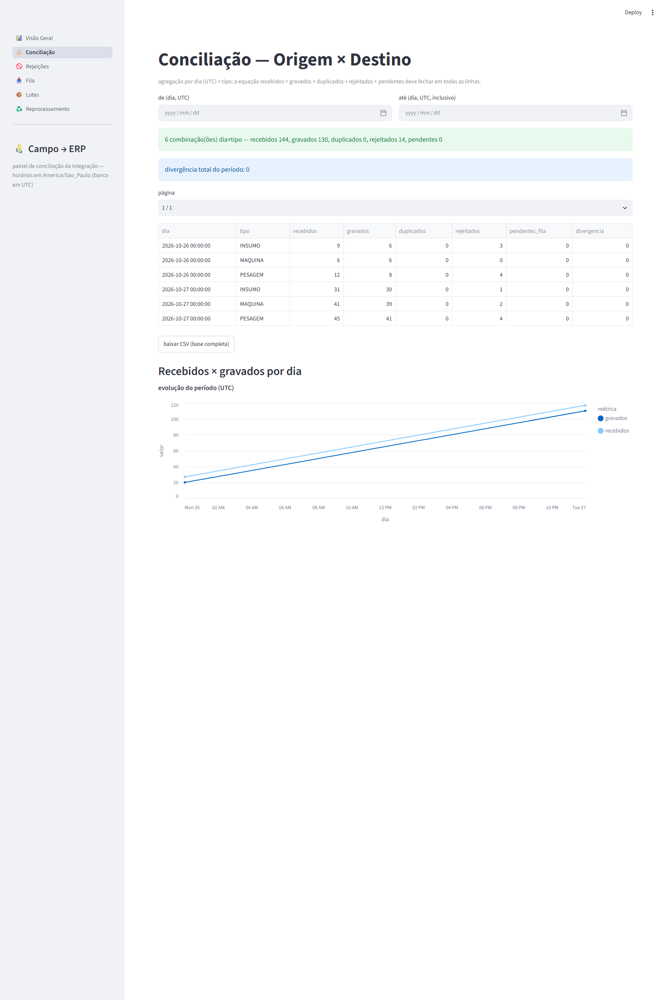
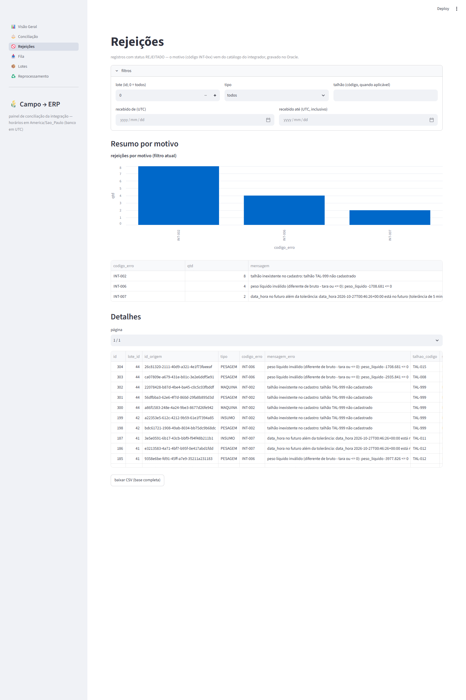
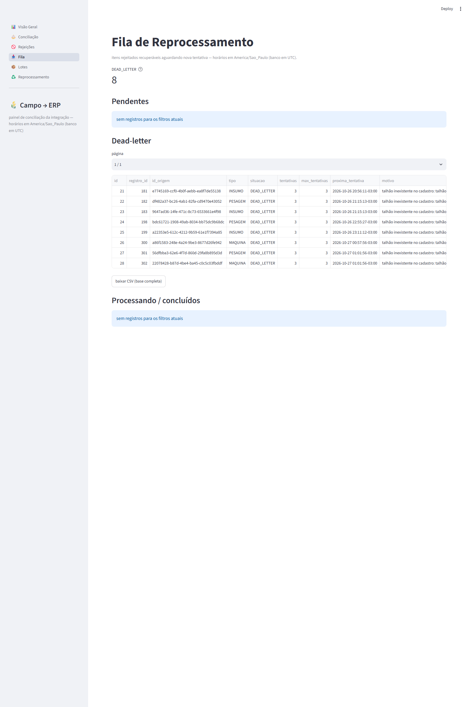
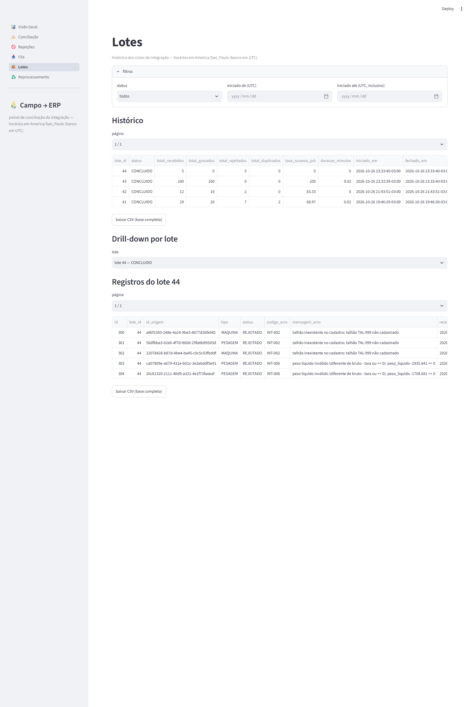
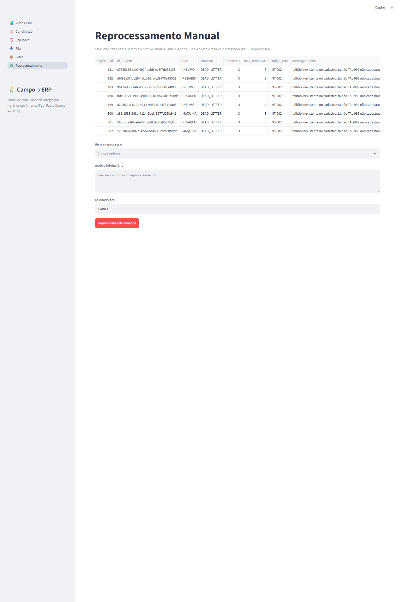

# Integração Sistema de Campo → ERP — Projeto 2 (demo fictícia)

[](https://github.com/Getsuga01/erp-campo/actions/workflows/ci.yml)
[](LICENSE)

> ⚠️ **DISCLAIMER**: projeto **fictício** de portfólio. Todos os dados, cadastros (talhões, equipamentos, itens), nomes de operadores, chaves de API e senhas são inventados; **nenhum** sistema, empresa, marca ou dado real está envolvido. Nada aqui se conecta a sistemas de produção.

Pipeline de integração que recebe **apontamentos operacionais** (pesagem, horas de máquina e insumos) de um sistema de campo simulado, valida contra um contrato de dados, grava no **Oracle XE** (ERP fictício), gerencia rejeições com **fila de reprocessamento + dead-letter** e oferece um **painel de conciliação** para monitorar divergências.

## Arquitetura



| Módulo | Pasta | Porta | Papel |
|---|---|---|---|
| A — Simulador do sistema de campo | `simulador_campo/` | 8001 | Origem fictícia: gera apontamentos com semente reprodutível, injeta falhas controladas, simula indisponibilidade |
| B — Serviço de integração | `integrador/` | 8002 | Ciclo agendado (5 min): consome, valida, grava por registro, rejeita, reprocessa com backoff 5/15/60 min, API administrativa |
| C — Painel de conciliação | `painel/` | 8501 | Visão Geral, Conciliação, Rejeições, Fila, Lotes e Reprocessamento manual |
| Banco | `db/` | 1521 | DDL, views, carga fictícia e grants (schemas `INTEGRACAO` e `ERP_SUPRIMENTOS`) |
| Testes | `tests/` | — | 85 testes pytest (regras 1–3, 4–8, 10, 12 e 13) **sem exigir Oracle local** |

## Como subir

### 1) Stack completo (docker compose — Oracle + 4 portas)

```powershell
copy .env.example .env          # informe ORACLE_PASSWORD (defaults de demo para o resto)
docker compose up -d --build    # oracle (1521) + simulador (8001) + integrador (8002) + painel (8501)
docker compose ps               # aguarde todos em (healthy)
```

- No **primeiro boot** do Oracle os scripts de `db/` (01→08) rodam via sqlplus automaticamente (demora alguns minutos); com o volume já existente, o banco é reaproveitado.
- Dentro da rede do compose os serviços se enxergam pelos nomes (`oracle`, `simulador`, `integrador`) — os defaults de "localhost" do código são sobrescritos pelo `environment` do compose.
- Parar tudo: `docker compose down` (o volume `campo-erp-oracle-data` preserva o banco).

### 2) Módulos manualmente (alternativa sem Docker para as apps)

```powershell
# venv na raiz do repo
.\.venv\Scripts\Activate.ps1

# Simulador (porta 8001)
uvicorn --app-dir simulador_campo main:app --port 8001

# Integrador (porta 8002) — em outro terminal
uvicorn --app-dir integrador main:app --port 8002

# Painel (porta 8501) — em outro terminal
streamlit run painel/app.py --server.port 8501 --server.headless true
```

Endereços: painel `http://localhost:8501` · docs das APIs `http://localhost:8001/docs` e `http://localhost:8002/docs`.

## Demo passo a passo

> PowerShell 5.1: use `curl.exe` (o `curl` do PowerShell é alias de `Invoke-WebRequest`).

```powershell
# 1) Gerar 100 apontamentos válidos na origem (semente fixa → reprodutível)
curl.exe -s -X POST -H "X-API-Key: campo-dev-key-001" -H "Content-Type: application/json" `
  -d '{\"quantidade\": 100, \"semente\": 42}' http://localhost:8001/simulador/gerar

# 2) Rodar um ciclo de integração agora (o job também roda sozinho a cada 5 min)
curl.exe -s -X POST -H "X-API-Key: integrador-dev-key-001" http://localhost:8002/ciclo/executar

# 3) Injetar falhas na origem e consumir de novo
curl.exe -s -X POST -H "X-API-Key: campo-dev-key-001" -H "Content-Type: application/json" `
  -d '{\"tipo_falha\": \"TALHAO_INEXISTENTE\", \"quantidade\": 3}' http://localhost:8001/simulador/injetar-falha
curl.exe -s -X POST -H "X-API-Key: integrador-dev-key-001" http://localhost:8002/ciclo/executar

# 4) Rejeições criadas: recuperáveis (INT-002) estão na fila; simular origem fora do ar
curl.exe -s -X POST -H "X-API-Key: campo-dev-key-001" -H "Content-Type: application/json" `
  -d '{\"duracao_segundos\": 60}' http://localhost:8001/simulador/modo-indisponivel
curl.exe -s -X POST -H "X-API-Key: integrador-dev-key-001" http://localhost:8002/ciclo/executar
# → lote FALHOU (INT-051) e o cursor não avançou: o próximo ciclo repega tudo

# 5) Reprocessar manualmente um registro rejeitado (motivo é obrigatório)
curl.exe -s -X POST -H "X-API-Key: integrador-dev-key-001" -H "Content-Type: application/json" `
  -d '{\"registro_ids\": [123], \"motivo\": \"correcao de cadastro\", \"acionado_por\": \"demo\"}' `
  http://localhost:8002/reprocessar

# 6) Conciliação — a equação deve fechar sempre (divergência 0)
curl.exe -s -H "X-API-Key: integrador-dev-key-001" http://localhost:8002/conciliacao
```

Acompanhe tudo no **painel** (`http://localhost:8501`): Visão Geral com os indicadores obrigatórios (recebidos × gravados × rejeitados × duplicados × pendentes, taxa de sucesso, top 5 motivos, tempos, idade da fila, divergência), Conciliação origem × destino por dia/tipo (divergências em vermelho), Rejeições com export CSV, Fila/dead-letter, histórico de Lotes e Reprocessamento manual.

### Capturas do painel (E2E real, dados ao vivo)

| Visão Geral (indicadores) | Conciliação (divergências em vermelho) |
|---|---|
|  |  |

| Rejeições (filtros + CSV) | Fila (pendentes + dead-letter) |
|---|---|
|  |  |

| Lotes (histórico + drill-down) | Reprocessamento (ação manual auditável) |
|---|---|
|  |  |

## Testes

```powershell
.\.venv\Scripts\python.exe -m pytest    # 85 testes em ~3s — sem Oracle local
```

Cobertura (plano, Fase 5): regra 1 (idempotência), 2 (cursor seguro), 3 (falha parcial), 4 (peso), 5 (cadastros), 6 (data UTC/futuro), 7 (retentativa), 8 (horas/revalidação), 9 (dead-letter/manual), 10 (equação de conciliação), 12 (retry de origem) e 13 (versão de contrato). Detalhes em `docs/decisoes_tecnicas.md` (item 13).

## Deploy online (demo pública — Oracle Cloud Always Free)

Para outros usuários testarem sem instalar nada, a stack roda inteira numa VM **gratuita e vitalícia** da Oracle Cloud (ARM Ampere A1, 2 OCPU/12 GB) — com a simetria de um Oracle Database rodando na nuvem da própria Oracle. Acesso público só ao painel, via **Cloudflare Tunnel** (HTTPS, sem abrir portas).

| Diferença vs. desenvolvimento local | Por quê |
|---|---|
| Imagem `gvenzl/oracle-free:23-slim-faststart` (não `oracle-xe:21-slim`) | XE 21c não tem port para ARM; 23ai Free é multi-arch. O PDB muda: `XEPDB1` → `FREEPDB1` |
| Scripts SQL de `db-deploy/` (gerados do `db/` pelo setup) | Fonte única: `deploy/setup-vm.sh` aplica `XEPDB1 → FREEPDB1` no sed |
| Nenhuma porta pública (só o painel em `127.0.0.1:8501` para o tunnel) | Oracle/simulador/integrador ficam inacessíveis de fora |
| Chaves de API obrigatórias e geradas com `openssl rand` | As chaves deste README são públicas no repositório |

```powershell
# 1) Criar conta em cloud.oracle.com (Free Tier) e uma VM Ubuntu 22.04+ ARM
#    shape VM.Standard.A1.Flex (2 OCPU, 12 GB) — Always Free. Abrir só a 22.

# 2) Na VM: clonar o repo e rodar o setup (idempotente)
git clone https://github.com/SEU-USUARIO/SEU-REPO && cd SEU-REPO
sudo bash deploy/setup-vm.sh    # Docker + .env com chaves fortes + db-deploy + stack + cloudflared

# 3) Tunnel (one-time) — o script imprime os passos: tunnel login → create
#    campo-erp → route dns painel.SEU-DOMINIO → config.yml → service install

# 4) Cloudflare Access (Zero Trust > Access > Applications): proteger o
#    painel por e-mail — o painel não tem auth própria (interno por design)
```

Com o tunnel no ar, distribua `https://painel.SEU-DOMINIO` — o ciclo de integração roda sozinho a cada 5 min e os testers acompanham tudo pelo painel.

## Endpoints

### Simulador (8001) — auth `X-API-Key: campo-dev-key-001` (exceto /health)

| Método | Rota | Descrição |
|---|---|---|
| GET | `/health` | Status do SQLite, total de apontamentos, modo indisponível (sem auth) |
| GET | `/apontamentos?cursor&limite` | Listagem paginada (limite 1–500, default 100); `proximo_cursor` = última linha servida |
| GET | `/apontamentos/{id_origem}` | Payload por UUID (404 se ausente) |
| POST | `/simulador/gerar` | `{quantidade 1–1000, semente, tipos?}` — gera válidos (409 se semente repetida sem limpar a base) |
| POST | `/simulador/injetar-falha` | `{tipo_falha, quantidade 1–100}` — 7 tipos de violação |
| POST | `/simulador/modo-indisponivel` | `{duracao_segundos 1–3600}` — 503 geral (menos /health) |

### Integrador (8002) — auth `X-API-Key: integrador-dev-key-001` (exceto /health)

| Método | Rota | Descrição |
|---|---|---|
| GET | `/health` | Status do serviço + Oracle + origem (sem auth) |
| GET | `/lotes` · `/lotes/{id}` | Histórico com filtros (`status`, `de`, `ate`, paginação) e detalhe com registros |
| GET | `/registros` | Filtros `status`, `tipo`, `codigo_erro`, paginação |
| GET | `/fila` | Filtro por `situacao` (PENDENTE/PROCESSANDO/CONCLUIDA/DEAD_LETTER) |
| GET | `/conciliacao` | View `V_CONCILIACAO_DIA_TIPO` por dia × tipo; `total_divergencias` |
| GET | `/metricas` | Taxa de sucesso, top 5 erros, tempo médio/p95, fila pendente, dead-letter |
| POST | `/ciclo/executar` | Dispara ciclo imediato (409 se já em andamento) |
| POST | `/reprocessar` | `{registro_ids, motivo, acionado_por}` — motivo obrigatório, audita em `INT_TENTATIVA` |

## Variáveis de ambiente (defaults de demo — nenhum segredo real)

| Prefixo | Variáveis | Uso |
|---|---|---|
| `CAMPO_` | `CAMPO_API_KEY`, `CAMPO_PORTA`, `CAMPO_DB_PATH` | Simulador (key default `campo-dev-key-001`; SQLite `data/simulador.db`) |
| `INT_` | `INT_ORACLE_DSN` (`localhost:1521/XEPDB1`), `INT_ORACLE_USUARIO/SENHA`, `INT_CAMPO_URL`, `INT_CAMPO_API_KEY`, `INT_API_KEY`, `INT_CICLO_INTERVALO_MIN` (5), `INT_REPROC_INTERVALO_MIN` (2), `INT_MAX_TENTATIVAS` (3), `INT_PESO_LIMITE_ALERTA` (60000), `INT_TOLERANCIA_FUTURO_MIN` (5), `INT_TIMEOUT_HTTP_SEG` (10), `INT_LIMITE_PAGINA` (100) | Integrador |
| `PAINEL_` | `PAINEL_ORACLE_DSN/USUARIO/SENHA`, `PAINEL_INTEGRADOR_URL` (`http://localhost:8002`), `PAINEL_INTEGRADOR_API_KEY`, `PAINEL_PORTA` (8501), `PAINEL_AUTO_REFRESH_SEG` (0 = off) | Painel |
| — | `ORACLE_PASSWORD` (arquivo `.env`) | Senha SYSTEM do container Oracle |

## Estrutura do repositório

```
suprimentos/
├── simulador_campo/   # Módulo A — origem fictícia (FastAPI + SQLite + Faker)
├── integrador/        # Módulo B — ciclo, validação, fila, API admin
├── painel/            # Módulo C — Streamlit (visão geral, conciliação, fila...)
├── db/                # DDL 01–08: schemas, cadastros, views, carga, grants
├── docs/              # contrato_dados · catalogo_erros · runbook · diagramas · decisões
├── tests/             # pytest — 85 testes sem Oracle local
├── docs/prints/       # capturas do painel (E2E real)
├── deploy/            # setup da VM de deploy online (Oracle Cloud ARM)
├── docker-compose.yml # stack completo: oracle + simulador + integrador + painel
├── docker-compose.deploy.yml # deploy online: 23ai Free/ARM + sem portas públicas
└── .env.example       # todas as variáveis (nenhum segredo real)
```

Documentação detalhada: [contrato de dados](docs/contrato_dados.md) · [catálogo de erros INT-001…099](docs/catalogo_erros.md) · [runbook de operação (5 cenários)](docs/runbook.md) · [diagramas](docs/diagrama_arquitetura.md) · [decisões técnicas](docs/decisoes_tecnicas.md).

## Limitações e próximos passos

- Single-worker: o reprocessador usa `ROWNUM = 1` antes do `FOR UPDATE SKIP LOCKED` (ver `docs/decisoes_tecnicas.md`, item 7 — irrelevante na demo, limitação real em multi-worker).
- Erros 4xx inesperados da origem viram `INT-099` sem retry — um código próprio (ex.: `INT-05x`) seria evolução natural do catálogo.
- A fila não tem expurgo automático de itens `CONCLUIDA` (auditoria da demo; em produção, particionamento/arquivamento).
- Evoluções naturais: políticas de retenção da fila; autenticação do painel (interno por design).
