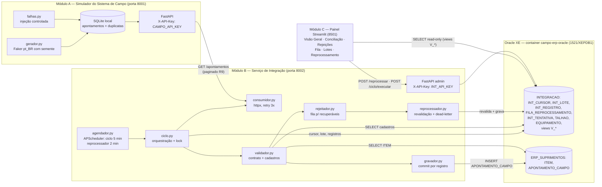
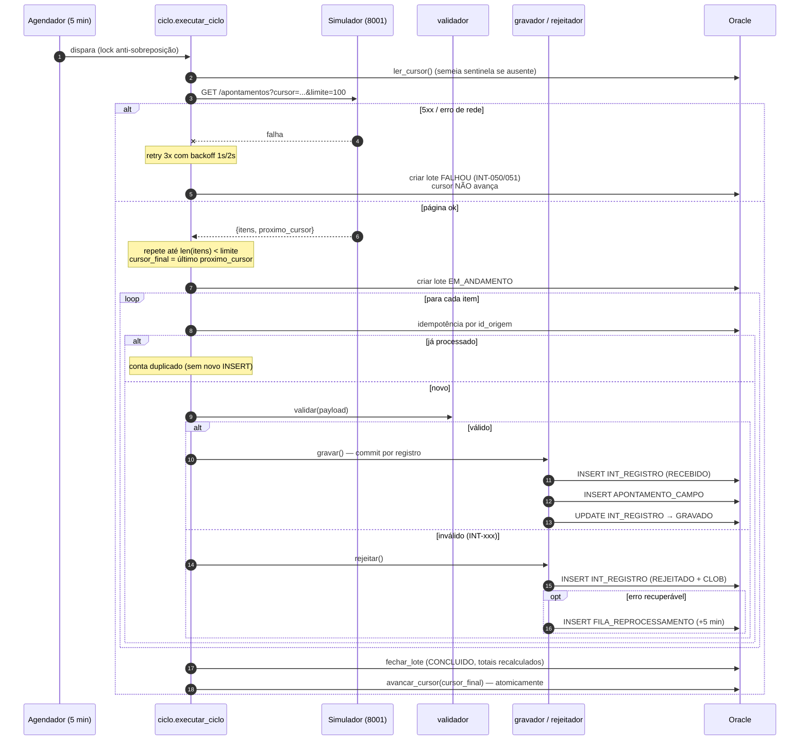
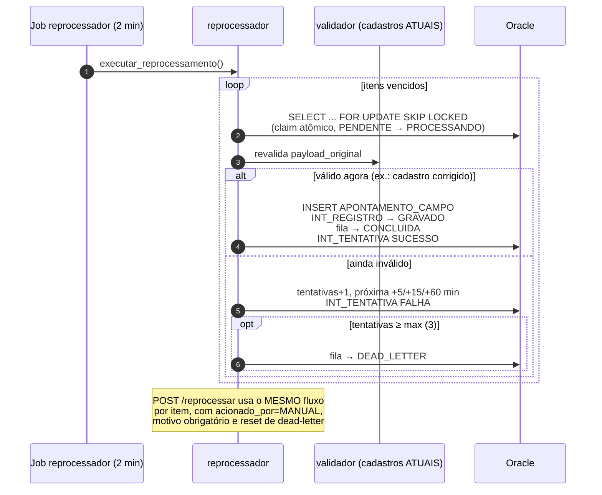
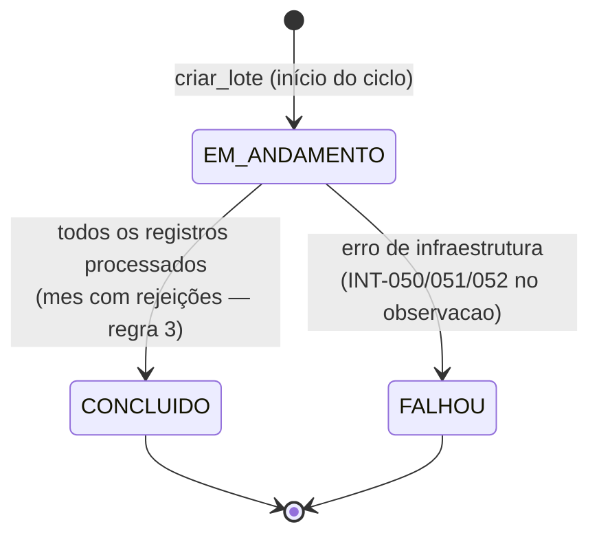
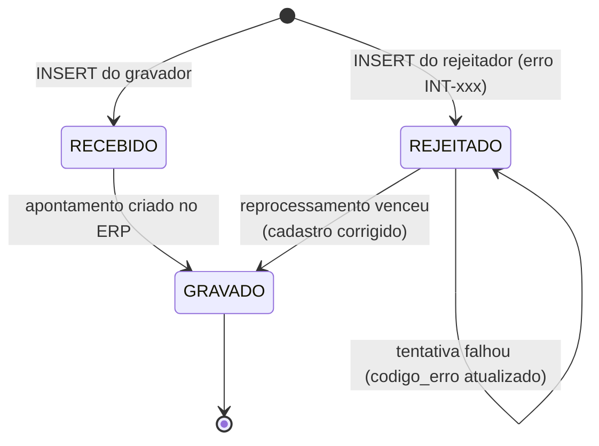
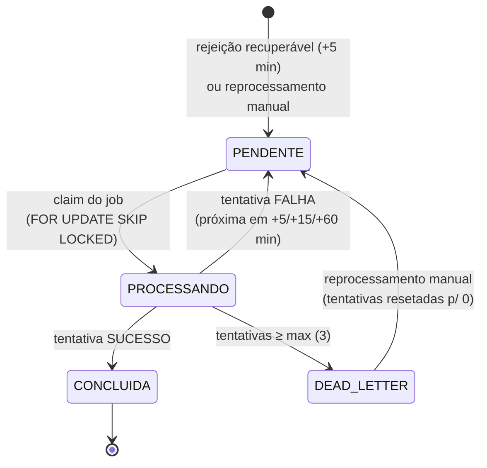

# Diagramas de Arquitetura — Integração Campo → ERP

> Diagramas Mermaid da demo fictícia. Fontes: código dos módulos (`simulador_campo/`, `integrador/`, `painel/`) e DDL de `db/`.

## 1. Arquitetura geral

Fluxo resumido: o **ciclo** (agendado a cada 5 min ou disparado via `POST /ciclo/executar`) lê o cursor, consome TODAS as páginas pendentes da origem, valida cada registro, grava os válidos no ERP e rejeita os inválidos (recuperáveis vão para a fila); só então fecha o lote e avança o cursor.

## 2. Sequência do ciclo de integração (com falhas)

Pontos-chave: **um registro inválido não derruba o lote** (regra 3); o **cursor só avança após o lote totalmente persistido** (regra 2) — crash no meio repega tudo e a idempotência converte os já gravados em duplicados; **erro de infraestrutura** (origem/banco) fecha o lote como `FALHOU` sem avançar o cursor.

## 3. Reprocessamento (fila + dead-letter)

## 4. Máquinas de estado

### 4.1 `INT_LOTE.status`

### 4.2 `INT_REGISTRO.status`

Nota: duplicados **não** geram nova linha em `INT_REGISTRO` — o reenvio do mesmo `id_origem` apenas incrementa `INT_LOTE.total_duplicados` (decisão de design; ver `decisoes_tecnicas.md`).

### 4.3 `FILA_REPROCESSAMENTO.situacao`

